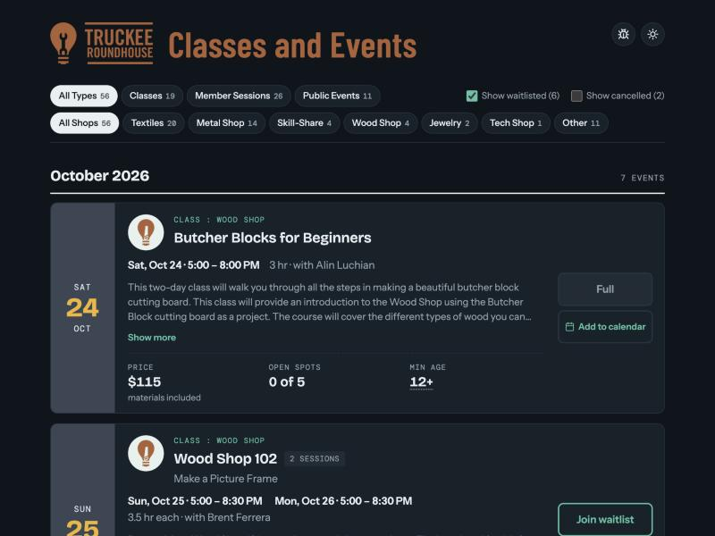

# Truckee Roundhouse class list

**[View the live class list →](https://danfoygel.github.io/roundhouse-class-list/)**

A single page listing all of Truckee Roundhouse's upcoming classes, member sessions, and public
events, pulled from their booking system — so you can browse and filter without digging through
the booking widget.

## What's on each tile

- **Title, subtitle, and shop** (Textiles, Metal Shop, Wood Shop, Skill-Share, Jewelry, Tech
  Shop, Ceramics, or Other), with an icon for the shop.
- **Description**, shown collapsed at first with "Show more" to read the rest.
- **Price**, or "No fee listed" if none was given, with notes like "materials included" or a
  per-session rate where that applies.
- **Minimum age**, if the class has one, and whether a minor needs to attend with an adult.
- **Status** — bookable, waitlistable, full, cancelled, or "Not bookable here" for listings that
  don't take seat reservations (register elsewhere, or just show up).
- **Instructor**.
- **A link to book** on Mindbody.

A class that runs across multiple days is shown as a single tile covering all of its sessions.

## Classes, member sessions, and public events

- **Classes** are paid instruction with a seat count.
- **Member sessions** are open shop time reserved for members (open ceramics, open wood shop,
  and the like).
- **Public events** are open to anyone, including drop-ins that don't take a seat reservation.

Use the "All Types" filter at the top to narrow the list to just one of these.

## Filtering

Filter buttons let you narrow by type and by shop, and checkboxes show or hide waitlisted and
cancelled events. The filters you choose are saved in the page address, so you can bookmark or
share a specific view — for example, the classes you can still book directly, or just the wood
shop's member sessions.

| Parameter | Values | Default |
|---|---|---|
| `type` | `classes`, `members`, `public` | all types |
| `shop` | `textiles`, `metal-shop`, `wood-shop`, `skill-share`, `jewelry`, `tech-shop`, `ceramics`, `other` (whichever shops have events) | all shops |
| `waitlisted` | `0` hides waitlisted events | shown |
| `cancelled` | `1` shows cancelled events | hidden |

For example, `?type=classes&waitlisted=0` is the classes you can still book directly, and
`?type=members&shop=wood-shop` is the wood shop's member sessions.

## Light and dark mode

The page follows your system's light/dark setting. Use the sun/moon button in the top right to
switch it; your choice is remembered in the browser.

## Data freshness

The page is a snapshot. Spots left and cancellations are as of the time it was last generated —
the footer shows when that was. It refreshes automatically every few hours, and weekly sessions
continue to show even past the last date listed.

## Change history

The clock icon, left of the others, opens an overlay listing what's changed since the last
refresh — new and removed listings, cancellations, reschedules, classes that filled up or opened
a spot, and the like — most recent first.

## Subscribe to the calendar

The calendar icon opens an overlay with a feed address you can subscribe to in Google Calendar,
Apple Calendar, or Outlook, so every class and event here shows up on your own calendar and stays
in sync as the schedule changes. The feed itself is also published directly, at
[`calendar.ics`](https://danfoygel.github.io/roundhouse-class-list/calendar.ics).

## Report a problem

The bug icon next to the sun/moon button opens the project's issue tracker in a new tab.

---

For how the page is built, hosted, and kept up to date, see [IMPLEMENTATION.md](IMPLEMENTATION.md).
